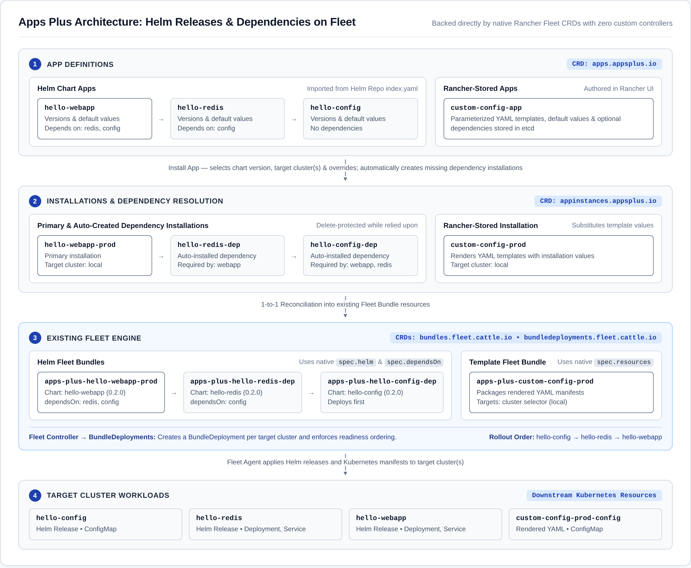
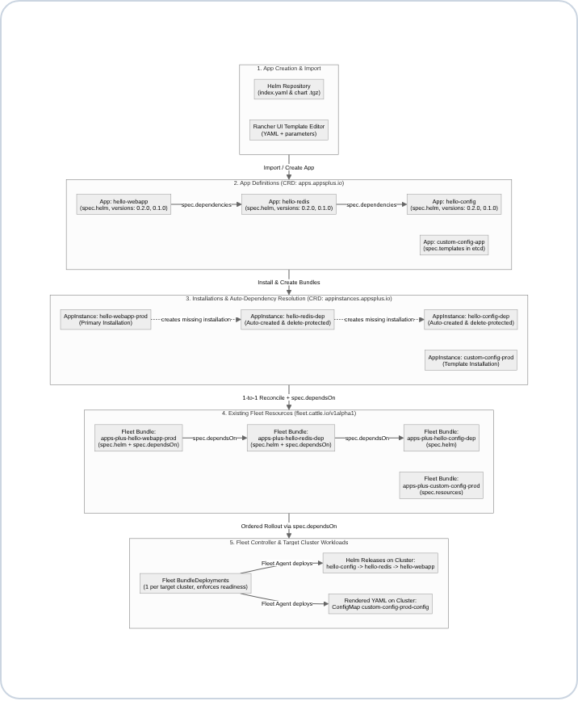
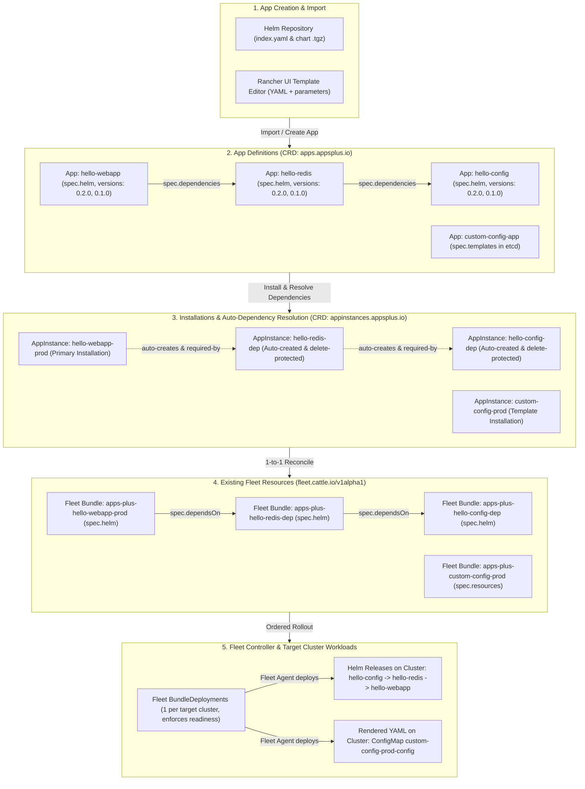

# Apps Plus

**Apps Plus** is a Rancher UI extension (**Continuous Delivery &rarr; Apps and Installations**) for defining, importing, and installing Helm charts and parameterized Kubernetes YAML templates with automatic dependency management—backed directly by **existing Rancher Fleet resources** (`Bundle` and `BundleDeployment`) with zero custom controllers.



---

## Demo Video

<video src="docs/apps-plus-demo.mp4" controls width="100%"></video>

- [Watch / Download MP4 (`docs/apps-plus-demo.mp4`)](docs/apps-plus-demo.mp4)
- [Watch / Download WebM (`docs/apps-plus-demo.webm`)](docs/apps-plus-demo.webm)

---

## Key Capabilities

- **Helm Repository Import with Dependency Configuration**: Point at any Helm repository URL (`index.yaml`) to discover and import all charts and their available versions as `App` resources, automatically extracting default `values.yaml` and chart dependencies. Use the **Dependencies** tab directly inside the **Import Helm Charts** dialog to inspect, add, or remove dependencies per chart before importing.
- **Helm & YAML App Editing (`Edit Config`)**: Both Rancher-stored YAML apps and imported Helm chart apps support **Edit Config**, with dedicated **Default Values** and **Dependencies** tabs to customize default values and manage explicit or implicit chart dependencies after import.
- **Rancher-Stored YAML Apps**: Author reusable Kubernetes YAML templates directly in Rancher using built-in variables (`${app}`, `${instance}`, `${cluster}`, `${namespace}`) and custom parameters with default values stored in `etcd`.
- **Automatic Dependency Resolution & Deletion Protection**:
  - Apps can declare explicit dependencies or inherit implicit dependencies from Helm charts (`Chart.yaml` `dependencies` or `appsplus.io/dependencies` annotations).
  - Installing an App automatically creates any missing dependency installations (`AppInstance`), wires Fleet's native `spec.dependsOn` ordering, and blocks deleting a dependency installation while other installations still rely on it.
- **Per-Installation Version & Value Overrides**: Choose which chart version to deploy, target one or more Fleet clusters (or provision a dedicated cluster per installation), and override default values with live rendered YAML previews.
- **Related & Deployed Resource Tracking**: Inspect the full chain of backing CRDs, `App` template storage, dependency relationships, Fleet `Bundle` and `BundleDeployment` resources, and downstream Kubernetes workloads from both the App and Installation detail views.

---

## End-to-End Flow & Dependency Graph





---

## Backing Custom Resources & CRDs

| Custom Resource (`Kind` / `apiVersion`) | Backing CRD (`CustomResourceDefinition`) | Provided By | Purpose & What It Stores |
| :--- | :--- | :--- | :--- |
| **`App`**<br>`appsplus.io/v1alpha1` | `apps.appsplus.io` | **Apps Plus UI Extension**<br>*(etcd storage only — no custom controller)* | Cluster-scoped catalog entry storing either `spec.helm` (`repo`, `chart`, `version`, `versions`) or `spec.templates` (parameterized YAML), plus default `spec.values` and `spec.dependencies`. |
| **`AppInstance`**<br>`appsplus.io/v1alpha1` | `appinstances.appsplus.io` | **Apps Plus UI Extension**<br>*(etcd storage only — reconciled by UI into a Fleet `Bundle`)* | Tracks an installed release of an `App` (target clusters, namespace, value overrides, selected chart version). Auto-installed dependencies are also `AppInstance` resources labeled `appsplus.io/dependency: "true"` and annotated with `appsplus.io/required-by`. |
| **`Bundle`**<br>`fleet.cattle.io/v1alpha1` | `bundles.fleet.cattle.io` | **Existing Rancher Fleet**<br>*(reconciled by Fleet controller)* | Standard Fleet `Bundle` (`apps-plus-<instance>`) created 1-to-1 for every `AppInstance`. Uses Fleet's native `spec.helm` for Helm chart releases, `spec.resources` for YAML templates, and `spec.dependsOn` for dependency ordering. |
| **`BundleDeployment`**<br>`fleet.cattle.io/v1alpha1` | `bundledeployments.fleet.cattle.io` | **Existing Rancher Fleet**<br>*(reconciled by Fleet agent)* | Created automatically by Fleet's controller for each target cluster; installs the Helm release or YAML resources on the cluster and reports readiness. |

---

## Installing in Rancher

1. In Rancher, navigate to **Extensions** (or **Local Cluster &rarr; Apps &rarr; Repositories**) and add the extension Helm repository:
   ```text
   https://codyrancher.github.io/apps-plus
   ```
2. Install the **Apps Plus** extension from the **Extensions** page.
3. Open **Continuous Delivery &rarr; Apps and Installations** in the left navigation menu.

---

## Repository Structure & Development

- `pkg/apps-plus/` — Rancher UI extension package:
  - `config/types.ts` — Resource constants, dependency annotations, and shared Related Resources row helpers.
  - `helm.ts` — Helm `index.yaml` discovery, `.tgz` chart extraction, and implicit dependency parsing.
  - `render.ts` — Template variable extraction, substitution (`${app}`, `${instance}`, `${cluster}`, `${namespace}`), and value typing.
  - `service.ts` — Automatic registration of `apps.appsplus.io` and `appinstances.appsplus.io` CRDs and the in-cluster Helm proxy service (`apps-plus-api`).
  - `models/appsplus.io.app.js` & `models/appsplus.io.appinstance.js` — Steve models handling recursive dependency installation, deletion protection, and 1-to-1 Fleet `Bundle` reconciliation.
  - `list/`, `edit/`, `detail/`, `components/` — Vue components for the grouped Apps & Installations list, Helm chart import modal (with **Charts** and **Dependencies** tabs), App edit view (for both YAML and Helm apps), shared `DependenciesEditor`, dependency & version popovers, values editors, and Related Resources tables.
- `docs/` — Architecture & flow diagrams (`architecture.png`, `flow-diagram.png`) and recorded demo video (`apps-plus-demo.mp4`, `apps-plus-demo.webm`).

If you edit the CRD schemas under `pkg/apps-plus/service/crds/` or the proxy server in `pkg/apps-plus/service/server.mjs`, regenerate the embedded TypeScript bundles:

```bash
node pkg/apps-plus/scripts/gen-crds.mjs
node pkg/apps-plus/scripts/gen-service.mjs
```
